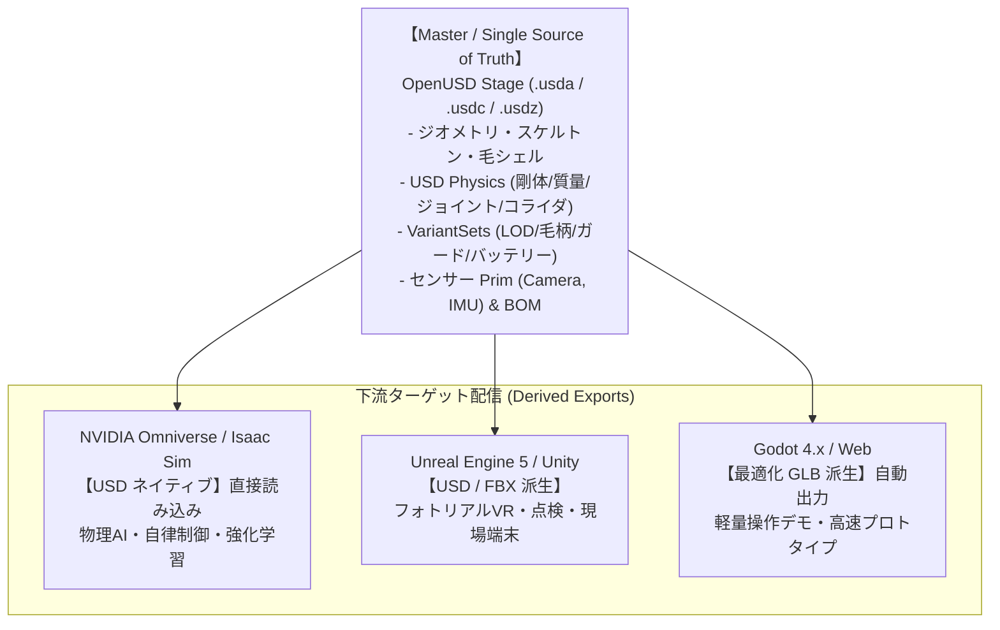

# ゲームエンジン・シミュレータ向けエクスポート統合ポリシー

- バージョン: 2.0.0
- 改定日: 2026-09-19
- 対象フェーズ: OpenUSD Integration Plan Phase 4
- 関連ドキュメント: `docs/openusd_integration_plan.md`, `docs/usd_physics_schema_spec.md`, `docs/usd_variants_sensors_spec.md`

---

## 1. 基本方針 (Single Source of Truth: OpenUSD)

`image2sim-framework` は、**OpenUSD（Universal Scene Description）をマスターアセット（Single Source of Truth / マスターデータ）** として採用します。

従来のモノリシックな GLB 単独運用から脱却し、**「USD をマスターとし、各ゲームエンジンやシミュレータの用途に応じて最適化された派生形式を自動生成・供給する」** 二層構造アーキテクチャへと移行しました。

---

## 2. エンジン別連携・配信仕様

### 2.1 NVIDIA Omniverse / Isaac Sim
- **連携形式**: **USD ネイティブ (`.usda` / `.usdc` / `.usdz`)**
- **受け渡し内容**:
  - `drone_assembly.usda`, `root_cat.usda` を直接参照。
  - `UsdPhysics` スキーマ（剛体、質量、重心、慣性テンソル、プロペラ回転軸 RevoluteJoint、凸包コライダ）。
  - `VariantSets` による動的切り替え（ガード有無、バッテリー諸元、LOD、毛柄）。
  - センサー Prim（FPV Camera, IMU）。

### 2.2 Godot 4.x / Web プレビュー
- **連携形式**: **最適化 GLB (派生出力: `drone2_derived.glb`, `cat_derived.glb`)**
- **運用方針**:
  - Godot の USD ネイティブ機能は実験段階にあるため、**CI/CD パイプラインにより USD マスターから最適化 GLB を自動生成** して供給する。
  - 既存の `godot/Godot3dcat` や `scripts/drone_model/godot_phase5` などのデモ環境との**完全な後方互換性**を保証する。
  - ビジュアルメッシュ、ボーン、アニメーション、テクスチャを 1 ファイルに自己完結（Pack）して出力。

### 2.3 Unreal Engine 5 / Unity
- **連携形式**: **USD Stage Actor / USD for Unity、またはクリーン FBX / GLB**
- **運用方針**:
  - 高精細レンダリング用途には USD Stage Actor による直接インポートを推奨。
  - モバイル・XR・組込端末向けには、パイプラインから派生出力された GLB/FBX を使用。

---

## 3. 移行期の二重運用ルール (Coexistence Guidelines)

1. **マスターデータの編集禁止対象**:
   - 派生出力された GLB / FBX を手作業で直接編集・改変することは禁止します。
   - 変更が必要な場合は、必ず上流の YAML 設定、Blender パイプライン、または USD オーサリングスクリプト側を更新し、派生出力を再生成します。
2. **自動ビルドによる整合性維持**:
   - `python pipeline_v2/run_usd_build.py` を実行することで、USD マスターの更新と同時に Godot 向け派生 GLB が自動再生成され、データの不整合（デシンク）を防止します。
3. **QAゲート・自動テストの二重チェック**:
   - pytest によるテストスイートにて、USD マスターのスキーマ検証（`test_usd_physics.py`, `test_usd_variants_sensors.py`）と、派生 GLB の互換性検証（`test_usd_export.py`, `test_usd_pipeline_phase4.py`）の双方を通過することを必須要件とします。

---

## 4. 座標系・正規化基準 (Blender / USD / GLB)

| 項目 | Blender (作業空間) | OpenUSD (マスター) | GLB (派生出力) |
|---|---|---|---|
| **Up 軸** | +Z Up | **+Y Up** | **+Y Up** |
| **Front 軸** | -Y Front | **+Z Front** | **+Z Front** (-Z in glTF) |
| **単位系** | メートル (1.0) | メートル (`metersPerUnit=1.0`) | メートル (1.0) |
| **足元・接地** | 接地点 `Z=0` | 接地点 `Y=0` | 接地点 `Y=0` |
| **中心基準** | X/Y 中心を原点 | X/Z 中心を原点 | X/Z 中心を原点 |

