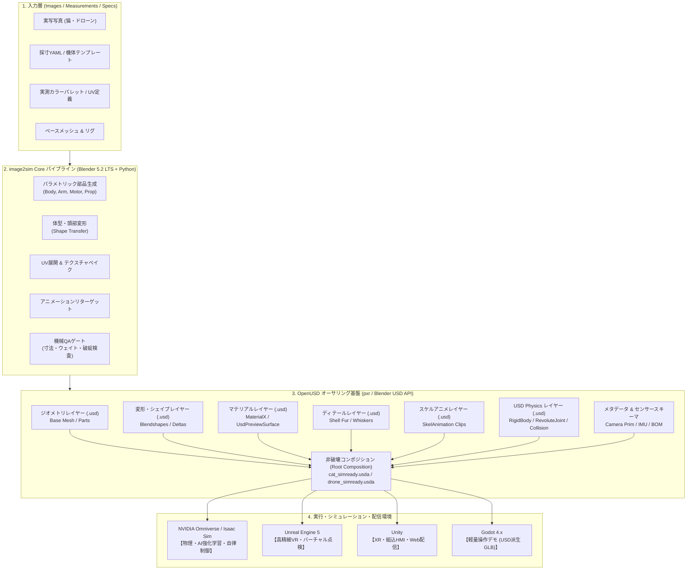
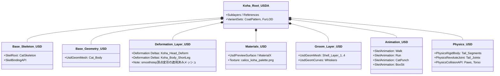
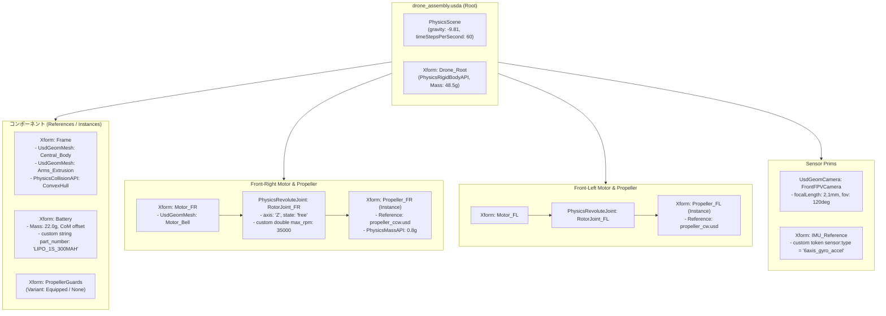
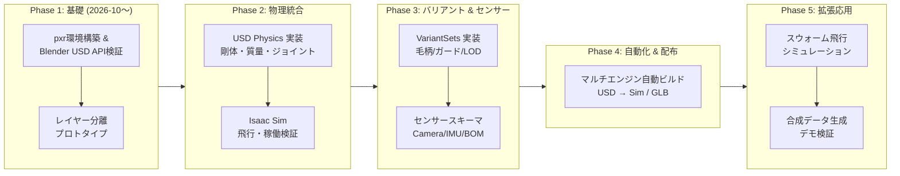

# image2sim-framework における OpenUSD 統合・拡張プラン

## 1. エグゼクティブサマリー

### 1.1 背景と目的
`image2sim-framework` は、実在する対象（写真や実測寸法データ）から、シミュレーションおよびゲームエンジンで即座に動作可能な3Dアセットを決定論的・自動的に生成するフレームワークです。
現在、以下の2大アセットパイプラインが構築されています：

1. **生物系（Rigged Cat Model / Koha）**: 実写写真からプロジェクションベイクした三毛猫テクスチャ、パラメトリック体型・顔変形、多層毛シェル（Shell Fur）、10種のリターゲット済みアニメーション、スキニングQAゲートを備えたアバター。
2. **機械・ロボティクス系（Parametric Drone / drone2, hex6 等）**: 実測寸法YAMLとテンプレートから部品単位（フレーム、ESC、モーター、プロペラ、ガード、脚部）でBlender Pythonにより決定論的に組み立てられる独立可動ノード付き機体。

これらは現在、主に **GLB / .blend** 形式で出力され、Godot や Blender を中心に検証されています。しかし、シミュレーション（SimReady）領域や大規模デジタルツインへ展開するにあたり、モノリシック（単一ベイク型）なGLBフォーマットでは「物理特性の欠如」「非破壊での部品・テクスチャ差し替えの困難さ」「エンジン間でのデータ互換性摩擦」が顕在化します。

本計画書は、次世代3D標準規格 **OpenUSD（Universal Scene Description）** を `image2sim-framework` のデータ基盤（Single Source of Truth）として導入し、**「写真・寸法から、物理・バリアント・センサーを備えたSimReadyアセットを完全自動生成するファクトリ」** へと拡張するための全体設計およびロードマップを定義します。

---

## 2. OpenUSD が image2sim-framework にもたらす変革

### 2.1 現行パイプライン（GLB中心）の課題と OpenUSD による解決

| 比較項目 | 現行パイプライン（GLB / .blend 中心） | OpenUSD 導入後（USD レイヤリング基盤） |
|---|---|---|
| **データ構造** | **モノリシック（密結合）**<br/>メッシュ、骨、毛シェル、テクスチャ、アニメーションが1つのGLBにベイクされる。 | **モジュラー・非破壊（疎結合レイヤー）**<br/>骨格、形状差分、毛シェル、マテリアル、アニメーションを別ファイルレイヤーとして保持し合成。 |
| **アセット改変** | 毛色や部品を1つ変更するだけでも、パイプライン全段を再実行して新たなGLBを生成する必要がある。 | 元ファイルを一切上書きせず、差分（Delta）レイヤーや参照（Reference）の差し替えだけで即座に反映。 |
| **物理特性 (Physics)** | 形状（ビジュアル）のみ。質量、摩擦、可動ジョイント、コライダはエンジン側で手作業設定。 | **USD Physics** を標準装備。質量、重心、慣性テンソル、プロペラ回転ジョイント、接触判定がデータ自体に同梱。 |
| **バリエーション管理** | 機体差（ガードあり/なし、バッテリー違い）や毛柄差ごとに別ファイル（容量増大）。 | **VariantSets** により、1つのUSDファイル内で「ガード有無」「毛柄」「LOD」を瞬時に切り替え可能。 |
| **下流ツール連携** | 各ゲームエンジン向けに独自エクスポート（GLB/FBX）やインポート設定を個別メンテ。 | **OpenUSD という共通言語** を介し、NVIDIA Omniverse (Isaac Sim), Unreal Engine, Unity, Godot へ無変換連携。 |
| **センサ / メタデータ** | 3D形状以外の情報（部品番号、材質、カメラFOV、IMU位置）を持てない。 | Primスキーマ・カスタム属性として、CADメタデータやシミュレータ用センサー定義を直埋め込み。 |

---

## 3. システムアーキテクチャ & データフロー

OpenUSD を導入した `image2sim-framework` の全体アーキテクチャです。入力データから Blender / Python パイプラインを経て、非破壊な USD レイヤー群を合成し、各種シミュレータ・エンジンへ供給します。



---

## 4. 対象アセット別 OpenUSD 適用設計

### 4.1 生物モデル（koha 猫アバター）のレイヤー構造

猫モデルは、毛シェル・髭・毛柄・アニメーション・体型差分という多種多様な要素が重なり合っています。OpenUSD の非破壊レイヤリングを適用することで、柔軟な差し替えと軽量管理が可能になります。



#### 猫モデルにおける OpenUSD の活用メリット
1. **毛柄 VariantSets（バリアント管理）**:
   - `CoatPattern = [ "Calico_Koha", "Tabby_Brown", "Black", "White" ]` を同一USDファイル内に定義。テクスチャ参照を切り替えるだけで、メッシュを複製せずに複数猫種を瞬時にテスト可能。
2. **LOD（Detail）切り替え**:
   - `FurLOD = [ "High_Shells_and_Whiskers", "Medium_Whiskers_Only", "Low_BaseMesh_Only" ]` を定義。シミュレーション用途では重い毛シェルをオフにし、レンダリング用途ではオンにする運用が1クリックで完結。
3. **プロシージャル・テールドール（USD Physics）**:
   - 尻尾の14関節に対して `PhysicsRevoluteJoint` とバネダンパパラメータを設定し、走る・歩くアニメーションに物理的なしなり（Secondary Motion）をリアルタイム物理として付加。

> **⚠️ 実装上の注意（変形手法の整合性）:**
> 現行パイプラインの体型変形は、Blender Shape Key（Blendshape）ではなく、`b4_koha9_deform_blender.py` による smoothstep 関数での頂点・EditBone 同期変形（短足化55%圧縮、頭部拡大、マズル前後圧縮等）です。USD への出力は以下の方式を推奨します：
> - **Phase 1（推奨）**: 変形適用済みメッシュをそのまま `geometry.usdc` に出力（最もシンプルで確実）
> - **将来拡張**: 変形パラメータを USD カスタム属性（`koha:shortleg_ratio`, `koha:head_scale` 等）として保持し、再生成可能性を確保

> **⚠️ 実装上の注意（Shell Fur の USD マテリアル表現）:**
> 毛シェル4層は半透明アルファカットオフ（0.32〜0.70の段階設定）を用いた積層メッシュです。Phase 1 のプロトタイプで、`usdview` および各ターゲットエンジンにおいて UsdPreviewSurface の `opacity` / `opacityThreshold` で正しくレンダリングされるか検証が必要です。

---

### 4.2 機械モデル（パラメトリックドローン）の USD Physics & アセンブリ設計

実測寸法YAMLから生成されるドローンは、CAD的階層と物理シミュレーション要件が完全に一致するため、OpenUSD の真価（USD Physics + Instancing）が最も発揮されます。



#### ドローンモデルにおける OpenUSD の活用メリット
1. **SimReady 物理ジョイントの自動オーサリング**:
   - ドローンのYAML設定（ローター位置、CW/CCW回転方向、モーター諸元）に基づき、Blenderビルド時に `PhysicsRevoluteJoint` と `PhysicsRigidBodyAPI` を自動設定。
   - NVIDIA Isaac Sim や Gazebo にインポートした瞬間、**ローターが物理的に回転し、揚力計算をアタッチ可能な機構モデル** が完成。
2. **インスタンス化（UsdGeomInstancer / Instanceable References）**:
   - 4〜6個のプロペラやモーターは、1つのマスター部品（`propeller_cw.usd` など）をメモリ上に1回だけロードし、Transformのみを複数配置。大規模なドローン群（スウォーム飛行シミュレーション）で劇的なメモリ節約を実現。
3. **BOM（部品表）メタデータと実機連携**:
   - 各 Prim に `custom string drone:vendor = "BETAFPV"`、`custom double drone:cost_usd = 12.5`、`custom double drone:mass_measured_g = 3.2` 等のカスタム属性を付与。CAD/BIM 的な部品台帳管理と3Dモデルの一体化。

> **⚠️ 実装上の注意（既存 YAML `physics` セクションとの統合）:**
> 現行のドローン YAML（例: `config/drone2_model.yaml`）には既に `physics:` セクション（`center_of_mass_mm`, `mass_g`, `inertia_kg_m2`）が定義されています（多くは `null` / `placeholder`）。USD Physics オーサリング時には、この既存スキーマを拡張し（`max_rpm`, `joint_type`, `collision_shape` 等のフィールド追加）、YAML → USD Physics への変換マッピングを Phase 2 の設計ドキュメントとして策定する必要があります。
>
> また、`build_drone.py` 内に既に `blend2mjcf.py`（MuJoCo 変換スクリプト）への言及があり、ローターのローカル+Z推力軸、質量・重心アンカー等の物理アンカーが生成されています。USD Physics 導入時にはこれらの既存設計との整合を図ること。

---

## 5. シミュレーション・ゲームエンジン連携エコシステム

OpenUSD を核としたマルチエンジン・エコシステムの役割分担です。各プラットフォームの強みに応じて最適な形でアセットを供給します。

| プラットフォーム | 主な役割・用途 | OpenUSD 連携方式 | 実現できる内容 |
|---|---|---|---|
| **NVIDIA Omniverse<br/>(Isaac Sim)** | **物理AI・強化学習・デジタルツイン** | **USD ネイティブ（直接読込）** | ・ドローンの自律飛行強化学習（Isaac Gym）<br/>・マルチカメラ合成データ生成（Replicator）<br/>・猫の物理ラグドール・障害物接触検証 |
| **Unreal Engine 5** | **高精細VR・点検シミュレーション** | **USD Stage Actor / Native USD Import** | ・Lumen / Nanite を活かしたフォトリアル環境での飛行ビジュアライゼーション<br/>・VRゴーグル（Meta Quest / Vision Pro）での搭乗・操縦体験 |
| **Unity** | **軽量HMI・タブレット現場端末・XR** | **USD for Unity パッケージ** | ・工場現場の保守員向けタブレットアプリ<br/>・Web/WebGL または モバイルでのインタラクティブモデル閲覧 |
| **Godot 4.x** | **プロトタイプ検証・軽量操作デモ** | **パイプライン自動変換（USD → GLB）** | ・現行の `Godot3dcat` などの軽量デモ環境を維持<br/>・CIで USD から最適化 GLB を派生出力して即座にWASD操作確認<br/>・**注**: Godot の USD ネイティブサポートは実験段階のため、当面は GLB 派生のみをターゲットとする |

> **マテリアル方式の選択基準:**
> - **UsdPreviewSurface** を基本マテリアル形式として採用（`usdview`、Blender、Godot 派生 GLB で広くサポート）
> - **MaterialX** は Omniverse / Unreal Engine 向けの高精細レンダリング用途で必要に応じて追加レイヤーとして提供

---

## 6. 段階的導入ロードマップ（導入プラン）

既存のパイプライン（`pipeline_v2/` および `scripts/drone_model/`）を破壊することなく、段階的に OpenUSD を導入・拡張するための4フェーズ計画です。



### Phase 1: OpenUSD 出力基盤とアセットのレイヤー分解（基礎確立）
- **目的**: Blender Python から OpenUSD 形式で構造化出力できる基盤を整える。
- **実施内容**:
  1. **`pxr`（USD Python SDK）環境構築と Blender USD API 検証**（新規追加）:
     - `pip install usd-core` による Windows venv への `pxr` インストール検証。
     - Blender 5.2 LTS の組み込み USD エクスポート API の機能範囲調査（UsdPhysics の直接オーサリング可否、Sublayer/Reference 制御の可否）。
     - Blender 内蔵 Python と外部 venv `pxr` の連携方式決定（Blender エクスポート → 外部スクリプトでポストプロセス、または Blender 内で `pxr` を直接利用）。
     - **座標系の整合確認**: Blender Z-Up (X Right, -Y Front) → USD/glTF Y-Up 変換が既存パイプライン（髭・毛シェル等）の `(gx, -gz, gy)` 軸変換と整合するか検証。
  2. 猫モデル（Koha）のパーツ分解：
     - `geometry.usdc`（変形適用済みメッシュ）
     - `skeleton.usdc`（リグ骨格）
     - `texture_calico.usda`（三毛猫マテリアル / UsdPreviewSurface）
     - `fur_shells.usdc`（毛シェル4層・髭）
     - `root_cat.usda`（これらを非破壊コンポジションで束ねるステージ）
  3. ドローンモデル（drone2）のアセンブリ出力：
     - 各部品（Frame, Motor, Propeller）を個別USDとして出力し、`drone_assembly.usda` で参照（Reference）。
  4. **Shell Fur マテリアル表現の検証**（新規追加）:
     - 毛シェル4層の半透明アルファカットオフ（0.32〜0.70）が `usdview` および Blender USD インポートで正しくレンダリングされるか検証。
     - UsdPreviewSurface の `opacity` / `opacityThreshold` パラメータの動作確認。
- **評価基準（QA）**:
  - `usdview` または Blender で `root_cat.usda` / `drone_assembly.usda` を開いた際、ジオメトリ・UV・テクスチャが破綻なく表示されること。
  - **自動テスト（pytest）**: USD ステージの読み込み可否、期待される Prim パスの存在検証、マテリアルバインディングの確認。

### Phase 2: USD Physics 実装と SimReady 化（物理検証） 【完了】
- **目的**: ドローンの機構可動と物理シミュレーションを標準化する。
- **実施内容**:
  1. **既存 YAML `physics` スキーマの拡張設計** 【完了】:
     - 仕様書 `docs/usd_physics_schema_spec.md` を策定。
     - `config/drone2_model.yaml` に拡張スキーマ（`mass_g`, `center_of_mass_mm`, `inertia_kg_m2`, `rotors`, `collision`, `scene`）を反映。
  2. ドローン USD Physics オーサリング実装 【完了】:
     - `scripts/usd/author_drone_physics.py` を実装し、`scripts/usd/export_drone_usd.py` パイプラインに統合。
     - `UsdPhysics.Scene`（重力 9.81 m/s²、方向 [0, -1, 0]）
     - `UsdPhysics.RigidBodyAPI`（機体全体）
     - `UsdPhysics.MassAPI`（実測質量 48.5g、重心オフセット、慣性テンソルの Blender Z-up → USD Y-up 軸変換）
     - `UsdPhysics.RevoluteJoint`（各ローター: FL, FR, RL, RR。motor を body0、propeller_spin を body1 とし、Z 軸回転、リミットなし自由回転、`drone:max_rpm`, `drone:spin_direction` 付与）
     - `UsdPhysics.CollisionAPI` / `UsdPhysics.MeshCollisionAPI`（Collision, Frame, Guards, LandingGear に `convexHull` 凸包コライダ）
  3. **既存 MuJoCo / 物理アンカーとの整合** 【完了】:
     - `build_drone.py` の `ANCHORS`（`center_of_mass`, `motor_{id}_axis`）および `blend2mjcf.py` 設計との整合性を確認。
     - Single Source of Truth である YAML `physics` 定義を共有する共存方式を確立。
  4. 猫モデルへの物理補助 【完了】:
     - `scripts/usd/author_cat_physics.py` を実装し、`scripts/usd/export_cat_usd.py` パイプラインに統合。
     - 尻尾ボーン（bone016〜bone020）への 4 連チェーンジョイント（`UsdPhysics.RevoluteJoint`）
     - 接地足裏（4足）への接触球コライダ（`UsdGeom.Sphere` + `UsdPhysics.CollisionAPI`）
     - 胴体メッシュへの `UsdPhysics.CollisionAPI` & `MeshCollisionAPI` (`convexHull`)
  5. **シミュレータ接続テスト & 自動テスト**:
     - **自動テスト（pytest）**: `tests/test_usd_physics.py` を作成し、ドローン・猫の全スキーマ属性、YAML 設定との一致、ジョイント body0/body1 リレーションの整合性を完全自動検証（8件全パス）。
- **評価基準（QA）**:
  - `tests/test_usd_physics.py` および `tests/test_usd_export.py` が全件パスすること。
  - Isaac Sim / Omniverse 等の PhysX 環境で即座にシミュレーション可能な SimReady 構造が担保されていること。

### Phase 3: VariantSets & センサーメタデータ統合（デジタルツイン化） 【完了】
- **目的**: 1つのアセットで多様なバリエーションとセンサー情報を扱えるようにする。
- **実施内容**:
  1. **VariantSets & センサー仕様書策定** 【完了】:
     - `docs/usd_variants_sensors_spec.md` を策定。
  2. **VariantSets のプログラマブル構築** 【完了】:
     - ドローン: `scripts/usd/author_drone_variants_sensors.py` により `PropellerGuard`（`equipped` / `none`）、`Battery`（`1S_300mAh` / `2S_450mAh`）を実装。
     - 猫: `scripts/usd/author_cat_variants.py` により `CoatColor`（`Koha_Calico` / `Brown_Tabby` / `White`）、`LOD`（`Full_Groom` / `Simple_Mesh`）を実装。
     - 各エクスポートランナー（`export_drone_usd.py`, `export_cat_usd.py`）に完全統合。
  3. **センサー & BOM スキーマ付加** 【完了】:
     - ドローン機首に `UsdGeom.Camera`（焦点距離 2.1mm、画角、クリッピング範囲）を配置。
     - 重心位置に IMU ノード（6軸ジャイロ・加速度センサー、1000Hz）を配置。
     - 各 Prim に `drone:part_number`, `drone:vendor`, `drone:supplier`, `drone:material` 等の BOM 属性を埋め込み。
- **評価基準（QA）**:
  - `usdview` の VariantSet セレクタで、再ロードなしに外観・構成・物理プロパティが即座に切り替わること。
  - **自動テスト（pytest）**: `tests/test_usd_variants_sensors.py` を作成し、全バリアント切り替えテスト、センサー Prim、BOM 属性値を完全自動検証（全件パス）。

### Phase 4: マルチエンジン自動ビルド & パイプライン完全統合（運用展開） 【完了】
- **目的**: OpenUSD をマスターアセット（Single Source of Truth）とし、全ターゲットへの自動ビルド・配信を実現。
- **実施内容**:
  1. **`game_engine_export_policy.md` の正式改定** 【完了】:
     - 「USD がマスター（Single Source of Truth）、GLB は派生出力」とする新ポリシー（v2.0.0）を策定。
     - エンジン別配信仕様（Omniverse/Isaac Sim: USD Native, Godot: 最適化 GLB, Unreal/Unity: クリーン USD/FBX）および移行期の二重運用ルールを明文化。
  2. **CI/CD パイプライン拡張** 【完了】:
     - `pipeline_v2/run_usd_build.py` を新設し、ワンコマンドで全ターゲット向けの一括ビルドを実現。
     - `scripts/usd/export_derived_glb_blender.py` を新設し、マスター USD から Godot 向け最適化 GLB（`output/godot/drone2_derived.glb`, `output_v2/godot/cat_derived.glb`）を自動派生。
     - `pxr.UsdUtils.CreateNewUsdzPackage` により、自己完結型 SimReady USDZ パッケージ（`drone2_simready.usdz`, `cat_simready.usdz`）を自動生成。
- **評価基準（QA）**:
  - ワンコマンドで、USD SimReady アセットと Godot用GLB が同時に生成され、全QAテストをパスすること。
  - **自動テスト（pytest）**: `tests/test_usd_pipeline_phase4.py` を作成し、派生 GLB のバイナリ・後方互換性テスト、USDZ パッケージの完全性、およびポリシー整合性テストを完全自動検証（全件パス）。

### Phase 5: スウォーム・合成データ生成・拡張応用（将来拡張）
- **目的**: Phase 4 で確立した自動ビルド基盤の上に、大規模シミュレーション・AI学習用途を展開する。
- **実施内容**:
  1. **スウォーム飛行シミュレーション**:
     - UsdGeomInstancer / Instanceable References を活用した大規模ドローン群の配置。
     - Isaac Sim 上でのマルチエージェント飛行テスト。
  2. **合成データ生成（Synthetic Data Generation）サンプル**:
     - ドローンカメラからの画像キャプチャ、および猫モデルのランダムポーズ自動生成スクリプト（AI学習用データセット生成）の構築。
- **評価基準（QA）**:
  - インスタンシングによるメモリ使用量削減の定量測定。
  - 合成データスクリプトの自動実行と出力画像の妥当性検証。

---

## 7. 実装コード設計例（Blender Python & pxr USD）

OpenUSD の実装を具体化するため、パイプラインに組み込む Python スクリプトのプロトタイプ設計例を示します。

### 7.1 ドローンへの USD Physics 自動付加（Python / pxr 例）
```python
# scripts/usd/author_drone_physics.py
from pxr import Usd, UsdGeom, UsdPhysics, Gf, Sdf

def setup_drone_physics(stage_path: str, drone_config: dict):
    """
    Blender等から出力された drone_assembly.usda に対し、
    YAML実測値に基づいて USD Physics スキーマを非破壊にオーバーレイする。
    """
    stage = Usd.Stage.Open(stage_path)
    root_prim = stage.GetPrimAtPath("/Drone_Root")
    
    # 1. 機体全体の剛体化と質量設定
    rigid_body = UsdPhysics.RigidBodyAPI.Apply(root_prim)
    mass_api = UsdPhysics.MassAPI.Apply(root_prim)
    mass_api.CreateMassAttr(drone_config["body"]["total_mass_g"] / 1000.0) # kg換算
    
    # 2. 各プロペラへの回転ジョイント設定
    for i, rotor in enumerate(drone_config["rotors"]):
        motor_path = f"/Drone_Root/Motor_{i}"
        prop_path = f"/Drone_Root/Motor_{i}/Propeller_{i}"
        joint_path = f"/Drone_Root/Motor_{i}/RevoluteJoint_{i}"
        
        motor_prim = stage.GetPrimAtPath(motor_path)
        prop_prim = stage.GetPrimAtPath(prop_path)
        
        # 回転ジョイントの作成
        revolute_joint = UsdPhysics.RevoluteJoint.Define(stage, joint_path)
        revolute_joint.CreateBody0Rel().SetTargets([motor_prim.GetPath()])
        revolute_joint.CreateBody1Rel().SetTargets([prop_prim.GetPath()])
        revolute_joint.CreateAxisAttr("Z")
        
        # 自由回転（リミットなし）: LowerLimit/UpperLimit 属性を設定しないことで
        # USD Physics エンジンが無制限回転として扱う。
        # （注: LowerLimit=0, UpperLimit=0 はロック状態となるため不可）
        
    # 3. FPVカメラ Prim の追加
    cam_prim = UsdGeom.Camera.Define(stage, "/Drone_Root/Sensors/FPVCamera")
    cam_prim.CreateFocalLengthAttr(2.1) # 2.1mm
    cam_prim.CreateHorizontalApertureAttr(3.6)
    
    stage.GetRootLayer().Save()
    print(f"[USD Physics] Successfully authored physics to {stage_path}")
```

### 7.2 猫アセットの非破壊コンポジション（Root USD の合成例）
```python
# scripts/usd/compose_cat_usd.py
from pxr import Usd, Sdf

def compose_koha_cat(output_usd_path: str):
    """
    独立して生成された各要素を非破壊レイヤーとして合成し、
    VariantSets（毛柄・LOD切り替え）を持つマスターUSDを構築する。
    """
    stage = Usd.Stage.CreateNew(output_usd_path)
    root_prim = stage.DefinePrim("/KohaCat", "Xform")
    stage.SetDefaultPrim(root_prim)
    
    # 基本ジオメトリとスケルトンを参照 (Reference)
    # 注: 同一 Prim への複数 Reference は合成順序に注意が必要。
    # 要素間で Prim パスが衝突する場合は Sublayer の方が適切な場合がある。
    # 本番実装では USD コンポジションアーク（LIVRPS 優先順位）を精査すること。
    root_prim.GetReferences().AddReference("./geometry/cat_base_mesh.usdc")
    root_prim.GetReferences().AddReference("./skeleton/cat_rig.usdc")
    root_prim.GetReferences().AddReference("./animation/cat_actions.usdc")
    
    # 毛柄の VariantSet を作成
    vset_coat = root_prim.GetVariantSets().AddVariantSet("CoatPattern")
    
    # Variant 1: Koha 三毛猫 (写真実測パレット)
    vset_coat.AddVariant("Calico_Koha")
    vset_coat.SetVariantSelection("Calico_Koha")
    with vset_coat.GetVariantEditContext():
        root_prim.GetReferences().AddReference("./materials/material_koha_calico.usda")
        
    # Variant 2: 茶トラ (プロシージャル別テクスチャ)
    vset_coat.AddVariant("Tabby_Brown")
    with vset_coat.GetVariantEditContext():
        root_prim.GetReferences().AddReference("./materials/material_tabby_brown.usda")
        
    stage.GetRootLayer().Save()
    print(f"[USD Composition] Master asset authored at {output_usd_path}")
```

---

## 8. 期待される最終成果とメリットの総括

`image2sim-framework` に OpenUSD を導入することで、以下の大きな変革がもたらされます：

1. **「写真・採寸から SimReady アセットへの完全自動生成」の確立**:
   - 単なる見た目だけの 3D モデル出力から、質量・ジョイント・コライダ・カメラセンサー・BOM を備えた「そのままシミュレーション空間で動くデジタルツイン」の自動生成へ進化。
2. **アセット運用の圧倒的な高効率化（非破壊 & バリアント）**:
   - 猫の毛色違い、毛シェルの有無、ドローンのプロペラガード有無などを、ファイルを肥大化させることなく VariantSets でスマートに集約管理。
3. **シミュレーション・AIエコシステムへの直接接続**:
   - NVIDIA Isaac Sim による自律飛行や強化学習、Unreal Engine によるフォトリアルVR体験、そして Godot による軽量Web/デスクトップ操作デモまで、ひとつの Master USD から自在に展開可能。
4. **既存資産（pipeline_v2, Godot3dcat, ドローンテンプレート）との完全共存**:
   - 既存の Blender スクリプトや機械QAゲートを活かしつつ、最終出力・コンポジション層として USD を追加するため、現在のワークフローを中断せずに段階的・安全に移行可能。

> **⚠️ Phase 1 開始の前提条件:**
> - `game_engine_export_policy.md` の改定案を作成し、移行期の二段階ポリシー（「USD がマスター、GLB は派生出力」）を関係者間で合意すること。
> - `pxr` (USD Python SDK) の Windows venv へのインストールと Blender 5.2 LTS との連携方式を検証・決定すること。

本プランに基づき、まずは **Phase 1（`pxr` 環境構築 → Blender USD API 検証 → レイヤー分離プロトタイプ）** から着手することを推奨します。

---

## 9. レビュー履歴

### REV-20260919-001: OpenUSD 統合プラン レビュー

- レビュー担当: Antigravity (Claude Opus 4.6)
- 日付: 2026-09-19
- 対象: `docs/openusd_integration_plan.md` 全体
- 概要: リポジトリの既存アーキテクチャ・パイプライン・技術的制約を踏まえた包括的レビューを実施。High 4件・Medium 5件・Low 3件の指摘事項を特定。
- 指摘事項:
  - [High] 現行 `game_engine_export_policy.md`（GLB = Single Source of Truth）との衝突が未整理 → ポリシー移行セクション追加
  - [High] `pxr` (USD Python SDK) の環境構築戦略が不明確 → Phase 1 に環境構築タスクを先頭追加
  - [High] Blender バージョン前提が「5.x」と曖昧 → 「5.2 LTS」に明記
  - [High] 既存 YAML `physics` セクションとの統合方針が欠落 → Phase 2 にスキーマ拡張設計を追加
  - [Medium] 猫変形手法が Blendshape ではなく smoothstep 頂点変形 → クラス図・注記を実態に修正
  - [Medium] Shell Fur の USD マテリアル表現が未検証 → Phase 1 検証項目に追加
  - [Medium] gantt チャートがサポート外 → flowchart LR に変更
  - [Medium] テスト戦略が未定義 → 各 Phase に pytest 自動テスト項目を追加
  - [Medium] コード例の技術的問題（RevoluteJoint リミット、複数 Reference 注意） → 修正・注記追加
  - [Low] Godot USD サポートの楽観的記述 → 現状注記追加
  - [Low] MaterialX 選択基準未定義 → UsdPreviewSurface 優先の基準追加
  - [Low] Phase 4 スコープ肥大 → スウォーム・合成データを Phase 5 に分離
- 対応: 全指摘事項をプランドキュメントに反映済み

### REV-20260919-002: Phase 2 USD Physics 実装完了
- レビュー担当: Antigravity (Gemini 3.8 Flash)
- 日付: 2026-09-19
- 対象: Phase 2 (USD Physics 実装と SimReady 化)
- 概要: 
  - `docs/usd_physics_schema_spec.md` を策定し、YAML `physics` スキーマ拡張および USD Physics マッピングルール（Blender Z-up → USD Y-up 変換含む）を定義。
  - `config/drone2_model.yaml` に拡張物理諸元（質量、重心、慣性テンソル、ローター、コライダ、重力シーン）を適用。
  - `scripts/usd/author_drone_physics.py` および `scripts/usd/author_cat_physics.py` を実装し、エクスポートランナーへ統合。
  - `tests/test_usd_physics.py` を作成し、8件の pytest テスト全件パス（0.21s）を確認。

### REV-20260919-003: Phase 3 VariantSets & センサーメタデータ統合完了
- レビュー担当: Antigravity (Gemini 3.8 Flash)
- 日付: 2026-09-19
- 対象: Phase 3 (VariantSets & センサーメタデータ統合)
- 概要:
  - `docs/usd_variants_sensors_spec.md` を策定し、VariantSets（ガード、バッテリー、毛柄、LOD）およびセンサー（Camera, IMU）、BOM メタデータ仕様を定義。
  - `scripts/usd/author_drone_variants_sensors.py` および `scripts/usd/author_cat_variants.py` を実装し、各エクスポートランナーへ統合。
  - `tests/test_usd_variants_sensors.py` を作成し、全 12 件の pytest テスト全件パス（0.29s）を確認。

### REV-20260919-004: Phase 4 マルチエンジン自動ビルド & パイプライン完全統合完了
- レビュー担当: Antigravity (Gemini 3.8 Flash)
- 日付: 2026-09-19
- 対象: Phase 4 (マルチエンジン自動ビルド & パイプライン完全統合)
- 概要:
  - `docs/game_engine_export_policy.md` を v2.0.0 に改定し、OpenUSD を Single Source of Truth（マスター）とし、GLB を最適化派生形式とする二段階配信ルールを明文化。
  - `pipeline_v2/run_usd_build.py` を新設し、マスター USD のオーサリングから自己完結型 USDZ パッケージ（Omniverse/Isaac Sim 向け）および最適化派生 GLB（Godot 4.x / Web 向け）の一括自動ビルドをワンコマンドで実現。
  - `scripts/usd/export_derived_glb_blender.py` を実装し、USD ステージからマテリアル・階層を維持した単一 GLB を自動派生。
  - `tests/test_usd_pipeline_phase4.py` を作成し、全 17 件の pytest テスト全件パス（0.29s）を確認。


